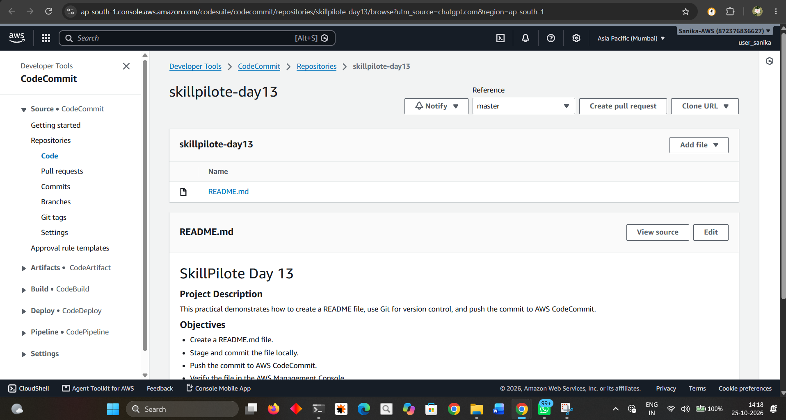

# SkillPilote Day 13 — AWS CodeCommit

## Project Description
This practical demonstrates creating an AWS CodeCommit repository, committing a README file with Git, pushing the commit to CodeCommit, and verifying the file in the AWS Management Console.

## Objectives
- Create or reuse an AWS CodeCommit repository.
- Create a README file with a project description.
- Stage and commit the file locally.
- Push the commit to AWS CodeCommit.
- Verify the file in the AWS Console.

## Tools Used
- AWS CLI
- AWS CodeCommit
- Git
- Windows PowerShell

## AWS Configuration
- Region: `ap-south-1` (Asia Pacific — Mumbai)
- Repository: `skillpilote-day13`
- Branch shown in the console screenshot: `master`

## Steps Performed
1. Verified the AWS CLI identity.
2. Created the `skillpilote-day13` CodeCommit repository.
3. Created `README.md` with the project description and objectives.
4. Staged and committed the README using Git.
5. Pushed the commit to AWS CodeCommit.
6. Opened the repository in the AWS Management Console and verified that `README.md` appeared.

## Screenshot Evidence

### Screenshot 1 — README verified in AWS CodeCommit
The screenshot below shows the `skillpilote-day13` repository in the AWS CodeCommit console, with the `master` branch selected and `README.md` visible.

## Credential and Security Notes
- Configure AWS CLI credentials using an approved IAM identity with the required CodeCommit permissions.
- Use the AWS CodeCommit Git credential helper or another approved HTTPS Git authentication method.
- Never place access keys, secret keys, passwords, or session tokens in scripts, screenshots, or Git repositories.

## Result
The README file was committed and pushed to AWS CodeCommit, and its presence was verified in the AWS Management Console.

## Evidence Note
The screenshot above documents the successful console verification. If required by the evaluator, also add a screenshot of the PowerShell output showing the successful Git commit and push. Do not fabricate terminal output; capture it from the actual run.
