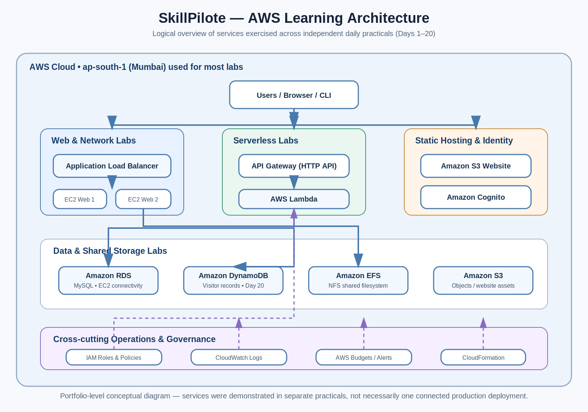

# Day 21 — GitHub Portfolio and Documentation

## Objective
Consolidate the SkillPilote AWS practicals into a public GitHub portfolio, document the daily exercises, add the architecture diagram, and publish the README using GitHub Pages.

## Work completed for this submission
1. Reviewed the existing public repository and its practical README files.
2. Prepared a repository-level portfolio README with links to the existing Day 10 and Day 12–20 practicals and notes on the Day 11 duplicates/extra Apache task.
3. Created an AWS architecture diagram in PNG format and included its editable SVG source.
4. Prepared the Day 21 practical report in DOCX format.
5. Documented the GitHub Pages publication steps.

## Architecture

## GitHub Pages setup
1. Open repository **Settings → Pages**.
2. Under **Build and deployment**, select **Deploy from a branch**.
3. Choose branch `main` and folder `/(root)`, then save.
4. Wait for deployment and verify the public Pages URL.

## Verification
- Confirm `README.md` is at the repository root.
- Confirm `architecture/SkillPilote_AWS_Architecture.png` renders in the root README.
- Confirm the Day 21 report and diagram are committed.
- Open the published site and check all relative links and image paths.

## Notes
The diagram is a logical overview of services used in separate practicals. It does not indicate that all components were deployed together. Day 1–9 README folders were not found in the reviewed repository tree; exact titles/content should be added only when those files exist.
