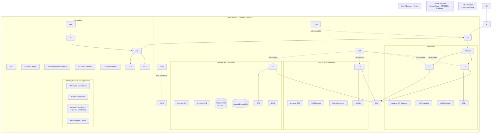

# SkillPilote --- 21-Day AWS Hands-On Practical Portfolio

> A consolidated portfolio of daily AWS cloud practicals completed as
> part of the SkillPilote learning roadmap. Each day demonstrates a
> focused cloud concept through hands-on implementation, AWS CLI/Console
> operations, verification, documentation, and resource cleanup.

## Project Overview

This repository contains the source code, infrastructure files,
practical notes, and screenshots for the SkillPilote 21-day AWS learning
journey.

**Repository:** `Sanika474/skillpilote-daily-tasks`  
**Primary AWS Region used:** `ap-south-1` (Asia Pacific --- Mumbai)  
**Local environment:** Windows + PowerShell, AWS CLI, Git and GitHub

## Learning Objectives

* Understand core AWS services and cloud architecture.
* Provision and configure compute, storage, database, networking,
identity, and serverless resources.
* Automate repeatable tasks using AWS CLI, scripts, and CloudFormation
where applicable.
* Verify deployments using health checks, logs, connectivity tests,
and AWS service status.
* Apply IAM, security-group, tagging, monitoring, and cost-awareness
practices.
* Maintain a clear GitHub record of implementation steps and evidence.

## Technology and Services

AWS EC2, VPC, IAM, S3, RDS (MySQL), Lambda, API Gateway, DynamoDB,
CloudFormation, ECS Fargate, EFS, Application Load Balancer, CloudWatch,
Cognito, AWS CLI, PowerShell, Git and GitHub.

## Repository Structure

Keep the existing day folders and their contents. The consolidated
repository should follow this pattern:

``` text
skillpilote-daily-tasks/
├── README.md
├── architecture/
│   └── aws-architecture.png
├── Day01-.../
│   ├── README.md
│   └── ...
├── Day02-.../
│   ├── README.md
│   └── ...
├── ...
├── Day20-AWS-Lambda-DynamoDB-API-Gateway/
│   ├── README.md
│   ├── lambda/
│   │   ├── index.mjs
│   │   ├── package.json
│   │   └── package-lock.json
│   └── screenshots/
├── Day21-GitHub-Portfolio/
│   ├── README.md
│   └── architecture/
│       └── SkillPilote\_AWS\_Architecture.png
└── architecture/
    ├── SkillPilote\_AWS\_Architecture.png
    └── SkillPilote\_AWS\_Architecture.svg
```

The folder names above are a suggested layout. Do not rename existing
practical folders merely to match the example; preserve the names
already committed in the repository.

## Day-wise Practical Index (reviewed against this repository)

|Day|Practical|Repository content / focus|
|-|-|-|
|01–09|Earlier foundational practicals|No matching Day 1–9 README folders were identified in the current repository tree. Add these only if the original folders/files are available; do not invent titles.|
|10|[AWS CloudFormation — S3 Bucket](Day-10-CloudFormation-S3/README.md)|JSON CloudFormation template, S3 bucket deployment report and evidence screenshots.|
|11|EC2 to Amazon RDS for MySQL|Multiple Day 11 report/implementation folders are present. They contain CloudFormation, SQL, scripts and evidence; clearly identify the final completed report and avoid treating draft/partial submissions as proof.|
|12|[AWS Lambda with API Gateway](Day12-AWS-Lambda-API-Gateway/README.md)|Node.js Lambda exposed through an HTTP API, test event and evidence.|
|13|[AWS CodeCommit](Day13-AWS-CodeCommit/README.md)|Create CodeCommit repository, initialise Git, commit README and push; PowerShell script and screenshot evidence.|
|14|[Amazon ECS Fargate — Nginx](Day14-ECS-Fargate-Nginx/README.md)|CloudFormation, ECS service/task, networking, deployment/cleanup scripts and Nginx verification.|
|15|[EC2 CloudWatch Logs](Day15-AWS-CloudWatch-Logs/README.md)|CloudWatch Agent forwards a sample EC2 log file to `/skillpilote/day15`.|
|16|[AWS Resource Tagging and Budget Alarm](Day16-AWS-Resource-Tagging-Budget-Alarm/README.MD)|Python/Boto3 tagging workflow and budget alert setup; verify script/evidence and final budget status.|
|17|[Amazon Cognito with S3-hosted Login Page](Day17-AWS-Cognito-S3-Login/README.md)|Cognito User Pool, browser app client, Amplify authentication and S3 static website hosting.|
|18|[Amazon EFS with EC2 and AWS Backup](Day18-AWS-EFS-EC2-Backup/README.md)|NFS v4.1 mount, test file, AWS Backup vault/plan and recovery point evidence.|
|19|[Application Load Balancer](Day19-AWS-Application-Load-Balancer/README.md)|Internet-facing ALB distributes HTTP traffic across two EC2 web servers using target health checks.|
|20|[AWS Lambda, DynamoDB and API Gateway](Day20-AWS-Lambda-DynamoDB-API-Gateway/README.md)|`POST /visitors` API stores visitor data in DynamoDB; IAM and CloudWatch support permissions and logs.|
|21|GitHub Portfolio and Documentation|This final practical: repository review, master README, architecture diagram, Git push and GitHub Pages.|

### Repository review notes

* The repository already contains Day 10 and Days 12–20 practical folders, with README files and a varying amount of code, templates, reports and evidence.
* The root `README.md` previously described the Day 13 CodeCommit practical. This portfolio README is intended to replace it as the repository landing page; retain the full Day 13 write-up in its dedicated folder.
* Several Day 11 folders exist (`SkillPilote\_Day11\_EC2\_RDS\_Practical`, `SkillPilote\_Day11\_RDS\_Implementation`, `skillpilote-day11-ec2-rds-revised`). Keep them until the authoritative final submission is chosen. One Day 11 README explicitly describes an incomplete/pending practical, so do not state all Day 11 artifacts are completed without checking the evidence.
* `Task-Apache-EC2` is an additional Apache-on-EC2 task and should remain documented as an extra task unless the course outline assigns it a particular day.
* No Day 1–9 folders were identified in the reviewed repository tree. Add their exact names/content when available; the master index intentionally does not fabricate them.

## Overall AWS Architecture

!\[SkillPilote AWS Architecture](architecture/aws-architecture.png)


The following Mermaid diagram is editable directly in GitHub Markdown.
It is a **portfolio-level logical view** of the services used across the
practicals, not a claim that every service was deployed together in one
production environment.



### Architecture notes

* **Networking and compute:** VPC, security groups, EC2, Application
Load Balancer and ECS Fargate.
* **Storage and databases:** S3, EFS, RDS for MySQL and DynamoDB.
* **Serverless:** API Gateway invokes Lambda; the Day 20 Lambda
workflow uses DynamoDB.
* **Identity and security:** IAM roles/policies provide service
permissions; Cognito demonstrates user authentication.
* **Operations and cost awareness:** CloudWatch supports
logs/monitoring; AWS Budgets supports cost alerts.
* **Portfolio:** GitHub stores code and documentation; GitHub Pages
publishes the repository README as a simple site.

## Security and Cost Practices

* Never commit AWS access keys, secret keys, passwords, tokens, `.env`
files or private SSH keys.
* Add sensitive files to `.gitignore`; rotate any credential
accidentally committed.
* Use least-privilege IAM roles and policies.
* Restrict security-group inbound rules to the required ports and
trusted sources.
* Stop or terminate billable resources after each practical when they
are no longer required.
* Check EC2 instances, EBS volumes/snapshots, RDS databases/snapshots,
load balancers, NAT gateways, Elastic IPs, ECS services, EFS file
systems, log groups and S3 buckets before considering cleanup
complete.
* Review AWS Billing and Budgets; deleting a resource does not
necessarily remove charges already incurred.

## How to Run / Review the Practicals

1. Open the relevant `DayXX-...` folder.
2. Read that folder's `README.md` before running commands.
3. Check prerequisites, AWS region, IAM permissions and resource names.
4. Review scripts and infrastructure templates before execution.
5. Run commands in the documented order (PowerShell commands are
intended for Windows unless stated otherwise).
6. Verify the expected AWS resource state and application output.
7. Capture screenshots that show the relevant resource/configuration
and successful test.
8. Follow the day's cleanup section to avoid ongoing charges.

> AWS commands may create billable resources. Review every command and
> the AWS pricing for the selected region before running it.

## Day 21 --- Final GitHub Portfolio Submission

Day 21 consolidates the previous practicals into a public,
well-documented portfolio.

1. Review all existing day folders and confirm their README, source
files, templates/scripts and screenshots are present.
2. Create or verify the public GitHub repository
`Sanika474/skillpilote-daily-tasks`.
3. Add this root `README.md` and the architecture diagram.
4. Add an accurate Day 1--21 index. Replace Day 1--10 placeholders with
the exact practical titles already in the repository.
5. Commit and push all local project folders to `origin main`.
6. Enable GitHub Pages from the repository's `main` branch and
`/ (root)` folder.
7. Open the published URL and test all headings, Mermaid rendering,
links and image paths.

### Suggested Day 21 folder

``` text
Day21-GitHub-Portfolio/
├── README.md
└── architecture/
    └── aws-architecture.png
```

The root README is the main portfolio landing page. The Day 21 folder
can contain the practical-specific notes and diagram source/image if
your existing submission convention expects each day to have its own
folder.

## Author

**Created as part of the SkillPilote AWS hands-on learning journey.**

GitHub: [@Sanika474](https://github.com/Sanika474)  
Repository:
[skillpilote-daily-tasks](https://github.com/Sanika474/skillpilote-daily-tasks)

\---

*Update this document whenever a practical's exact title, implementation
details, source files, or evidence changes. Keep the documentation
consistent with what is actually present in the repository.*

